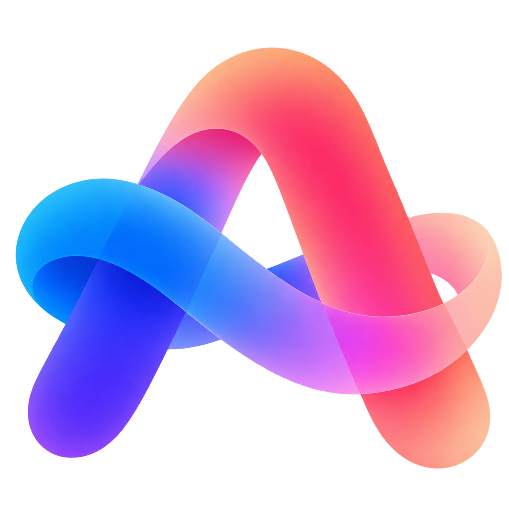

  

<h1 align="center">myArc, forever yours.</h1>

Arc was an awesome browser. Now it's being [sunsetted](https://arc.net/). We're building myArc to bring back the browsing experience people loved, as an open-source browser that keeps your workspace local and works without an account.

The goal is familiar everyday browsing, including the sidebar, Spaces, keyboard commands, Peek, Split View and Boosts. Your setup stays exportable, and browsing won't depend on a subscription.

AI is an optional layer, off by default. The plan supports models running on your machine, your own API keys (BYOK), or an optional paid hosted service. You choose what a provider can access. Pages won't be uploaded in the background, and hosted features won't be required for local browsing.

**Planning stage.** Browser, importer and animated onboarding are not implemented yet.

`myArc` is a working name. This project is independent of The Browser Company and Atlassian.

## How we're building it

This is an independent reimplementation based on public documentation and permitted observations of Arc's behavior. We're writing myArc's own code, with Chromium providing the existing browser foundation. Our [development workflow](docs/ARTCRAFT-WORKFLOW.md) takes cues from Artcraft's public projects.

The planned architecture uses Rust for workspace state, import, storage and commands. Chromium's browser engine and services remain C++, including its extension support. Foundation and compatibility still need proof.

CLI and MCP browser control are launch requirements. With your permission, external tools and AI agents should be able to inspect real pages, interact with them and manage tabs through the same commands as the UI. Both interfaces will work with built-in AI turned off.

## Product commitments

These are design commitments, not claims that the planned features work today.

- Develop in public with build instructions and clear license information. Keep myarc-owned code and documentation permissively licensed; upstream components retain their own licenses.
- Build a native desktop browser on Chromium's complete browser layer, with a Rust-owned workspace core. Do not use Electron as the production shell or claim the whole browser is pure Rust.
- Preserve Arc's useful layouts, shortcuts, Spaces, and workspace habits. Onboarding should teach the differences instead of forcing people to relearn browsing.
- Keep workspace data local and exportable, with no required account or background uploads to AI services. Websites still use the network; ownership of the workspace is the promise.
- Make CLI and MCP supported launch interfaces over the same commands as the UI, with scoped access and an obvious Stop control.
- Keep AI optional: off by default, with local models, user API keys, and an optional paid hosted service. The browser must remain useful without that service.
- Support Chrome extensions through a proven browser implementation, with published compatibility results.
- Include Boosts, beginning with appearance, CSS, and element hiding. No Easels.
- Launch with an animated onboarding experience that teaches by doing.

## Start here

| Document | Purpose |
| --- | --- |
| [Product plan](docs/PRODUCT.md) | Audience, advantage, scope, and commercial direction |
| [Roadmap](ROADMAP.md) | Milestones, dates, dependencies, and release gates |
| [Animated onboarding](docs/ONBOARDING.md) | Storyboard, interaction design, motion, and acceptance criteria |
| [Architecture](docs/ARCHITECTURE.md) | Chromium recommendation, alternatives, and foundation experiment |
| [Arc migration](docs/MIGRATION.md) | Import contract, data boundaries, recovery, and portable export |
| [AI and services](docs/AI.md) | Provider choices, privacy, and sustainable hosted billing |
| [CLI and MCP browser control](docs/CONTROL-PROTOCOL.md) | Shared tools, page interaction, user grants, and external AI agents |
| [Boosts](docs/BOOSTS.md) | Phased scope and safe execution |
| [Parity register](docs/PARITY.md) | What is wanted, what is known, and what is actually implemented |
| [Ranked gaps](docs/GAPS.md) | Work order and launch blockers |
| [Scorecard](docs/SCORECARD.md) | Proposed budgets and evidence needed to ship |
| [Agent workflow](AGENTS.md) | How to contribute without drifting from the product |
| [Artcraft methods applied](docs/ARTCRAFT-WORKFLOW.md) | Practical lessons, current enforcement and implementation triggers |
| [Behavior contracts](plan/BEHAVIOR-CONTRACTS.md) | Precise interactions and unresolved questions before coding |
| [Execution plan](plan/EXECUTION.md) | Implementation workstreams and definitions of done |
| [Research](docs/RESEARCH.md) | Primary sources, limitations, and Artcraft lessons |

## What makes this plan different

Migration and animated onboarding lead the work. Browser security, extension support, and data durability decide whether it can ship. AI monetization follows a useful browser rather than determining the browser experience. Feature breadth is tracked separately from demonstrated daily-use reliability.

The current recommendation is a **Rust core for myarc's workspace, importer, persistence, and commands**, integrated through a small patch set over Chromium's complete browser layer, subject to a one-week feasibility gate. Chromium's engine and existing browser services remain C++. This is not a commitment to write a browser engine, use Electron, or rebuild Chrome's extension platform.

## Immediate next step

Follow [plan/EXECUTION.md](plan/EXECUTION.md), starting with task MA-001. Work toward an Arc preservation tool and a safe desktop alpha before attempting full replacement. The December 2026 milestones are conditional targets, not release promises.

## Contributing

Read [AGENTS.md](AGENTS.md) and [CONTRIBUTING.md](CONTRIBUTING.md). Current documents and original tooling are MIT licensed; future upstream code retains its own notices and license obligations. A chosen browser foundation must receive a separate license review before integration or distribution.

Run `python3 tools/check_docs.py` for the same relative-link check used by the documentation CI. Browser/Rust verification remains planned until implementation exists.
