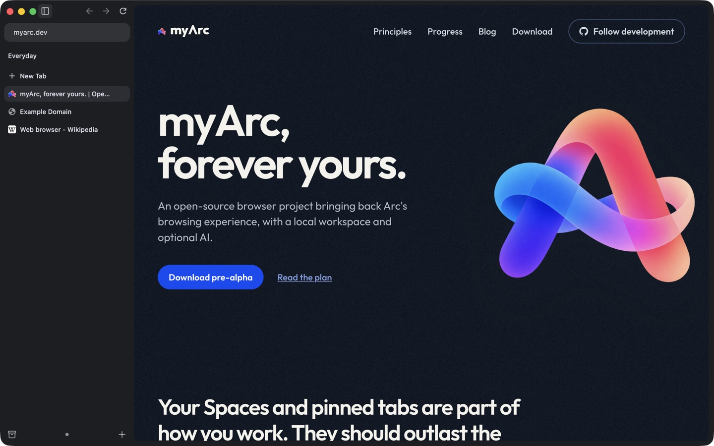

<p align="center">
  
</p>

<h1 align="center">myArc, forever yours.</h1>

<p align="center">
  <a href="https://myarc.dev/download/"><b>Download pre-alpha</b></a> · <a href="https://myarc.dev">Website</a> · <a href="https://myarc.dev/blog/">Blog</a>
</p>

Arc is being [sunsetted](https://arc.net/). myArc is an open-source browser that brings back the way Arc works: the sidebar, Spaces, pinned tabs and the command bar. It runs on Chromium, needs no account and keeps your workspace on your Mac.



## Try it

The [pre-alpha nightly](https://myarc.dev/download/) runs on Apple silicon Macs with macOS 26 or later. It's for trying the shell, not for daily or sensitive browsing: it has no automatic or security updates, it isn't notarized, and recent tabs can be lost after a crash. The download page lists every known limitation.

What works today:

- Browsing with Chromium extensions
- A glass sidebar with Favorites, pinned tabs and temporary tabs next to a rounded page card
- Creating, switching and renaming Spaces
- The command bar (Cmd+L) and Arc's shortcuts, such as Cmd+S to hide the sidebar and Cmd+Shift+C to copy the address
- A native Settings window (Cmd+,)

## Where it's going

- Arc's layouts, shortcuts and habits, with an animated onboarding that shows what's different.
- Import from Arc, and export of your workspace at any time.
- No account, subscription or analytics about how you browse.
- Ads and trackers blocked by default, with per-site controls.
- Peek, Split View and Boosts.
- Control from the command line and MCP, so scripts and AI agents can use the same commands as the UI, with your permission.
- Optional AI, off by default, using models on your machine or your own API key.

Plans and their status are in the [roadmap](ROADMAP.md) and [ranked gaps](docs/GAPS.md).

## Build and contribute

myArc is a small patch set over Chromium, with a Rust core for workspace state and commands. The [foundation recipe](browser/README.md) covers the Chromium checkout, the build and the nightly packaging. Work happens in small loops, one Arc screenshot and one task at a time; [the workflow](docs/WORKFLOW.md) explains it. Read [AGENTS.md](AGENTS.md) and [CONTRIBUTING.md](CONTRIBUTING.md) before sending changes.

Checks:

```sh
python3 tools/check_docs.py
cargo fmt --all -- --check
cargo clippy --workspace --all-targets --locked -- -D warnings
cargo test --workspace --locked
python3 tools/export_patches.py --check   # needs the Chromium checkout
```

More detail: [architecture](docs/ARCHITECTURE.md), [Arc migration](docs/MIGRATION.md), [CLI and MCP control](docs/CONTROL-PROTOCOL.md), [AI](docs/AI.md) and the [development log](log/DEVLOG.md).

## License

myArc is licensed under [GPL-3.0](LICENSE). Releases and commits before 29 October 2026 remain available under MIT; the [blog post](https://myarc.dev/blog/2026-10-29-gpl/) explains the switch. Chromium and other bundled components keep their own licenses, listed in [ATTRIBUTION.md](ATTRIBUTION.md).

myArc is independent of The Browser Company and Atlassian.
