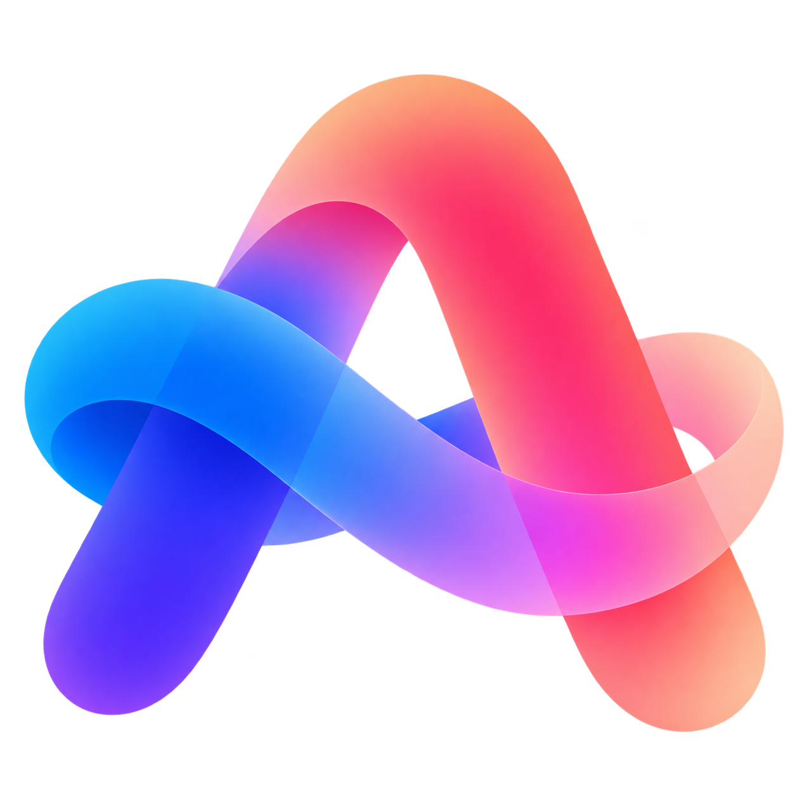
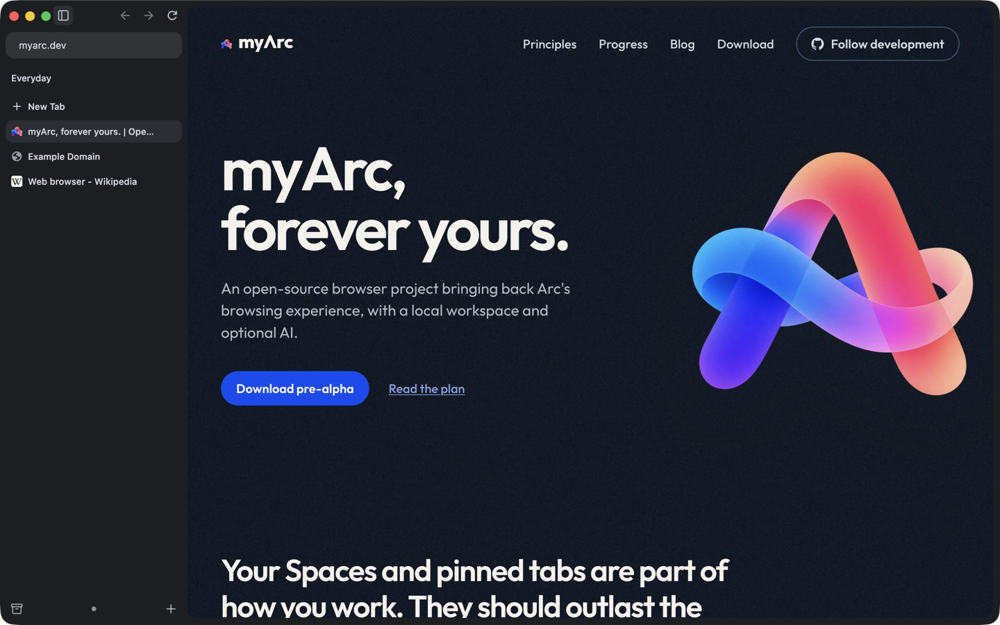

<p align="center">
  
</p>

<h1 align="center">myArc, forever yours.</h1>

<p align="center">
  <a href="https://myarc.dev/download/"><b>Download alpha</b></a> · <a href="https://myarc.dev">Website</a> · <a href="https://myarc.dev/blog/">Blog</a>
</p>

Arc is being [sunsetted](https://arc.net/). myArc is an open-source browser that brings back the way Arc works: the sidebar, Spaces, pinned tabs and the command bar. It runs on Chromium, needs no account and keeps your workspace on your Mac.



## Try it

The [alpha build](https://myarc.dev/download/) runs on Apple silicon Macs with macOS 26 or later. It's for trying the shell, not yet for daily or sensitive browsing: recent tabs can be lost after a crash, and Chromium fixes arrive with the next release. Builds are signed, notarized and update themselves in place, and the download page lists every known limitation.

What works today:

- Browsing with Chromium extensions and bundled ad and tracker blocking (uBlock Origin Lite)
- A glass sidebar with Favorites, pinned tabs, folders and temporary tabs next to a rounded page card
- Creating, switching, theming and renaming Spaces across multiple Profiles
- Peek, two-pane Split View and Little Arc
- One-click import from Arc (`StorableSidebar.json`) and Markdown export import
- The command bar (Cmd+L / Cmd+T) and Arc's shortcuts, such as Cmd+S to hide the sidebar and Cmd+Shift+C to copy the address
- Opt-in CLI (`myarc`) and MCP (`myarc mcp`) browser control in a separate Agent Space
- A native Settings window (Cmd+,) and animated welcome tour

## Where it's going

- Nested folders, multi-pane Split View, Boosts and remaining Arc parity.
- Workspace export and full migration coverage across Profiles.
- Durability, accessibility, responsiveness and extension matrix gates for daily-use beta.
- Optional AI, off by default, using models on your machine or your own API key.

The [roadmap](ROADMAP.md) and [ranked gaps](docs/GAPS.md) track what comes next.

## Build and contribute

myArc is a small patch set over Chromium, with a Rust core for workspace state and commands. The [foundation recipe](browser/README.md) covers the Chromium checkout, the build and release packaging. Work happens in small loops, one Arc screenshot and one task at a time; [the workflow](docs/WORKFLOW.md) explains it. Read [AGENTS.md](AGENTS.md) and [CONTRIBUTING.md](CONTRIBUTING.md) before sending changes.

Checks:

```sh
python3 tools/check_docs.py
cargo fmt --all -- --check
cargo clippy --workspace --all-targets --locked -- -D warnings
cargo test --workspace --locked
python3 tools/export_patches.py --check   # needs the Chromium checkout
```

More detail: [alpha checklist](docs/ALPHA.md), [architecture](docs/ARCHITECTURE.md), [Arc migration](docs/MIGRATION.md), [CLI and MCP control](docs/CONTROL-PROTOCOL.md), the [Claude Code skill](skills/myarc-browser/SKILL.md) for driving myArc through the `myarc` CLI, [AI](docs/AI.md) and the [development log](log/DEVLOG.md).

## License

myArc is licensed under [GPL-3.0](LICENSE). Releases and commits before 29 October 2026 remain available under MIT; the [blog post](https://myarc.dev/blog/gpl/) explains the switch. Chromium and other bundled components keep their own licenses, listed in [ATTRIBUTION.md](ATTRIBUTION.md).

myArc is independent of The Browser Company and Atlassian.
