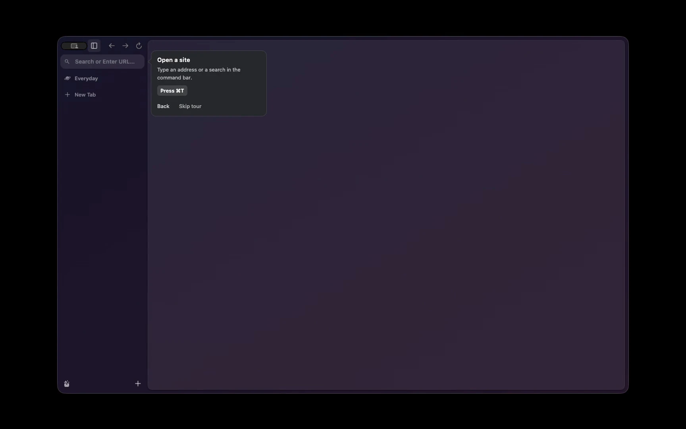

HTML: https://myarc.dev/blog/a-proper-welcome/

[All posts](https://myarc.dev/blog/)

# A proper welcome

November 20, 2026

[Mauricio Wolff](https://github.com/bitbonsai)2 min read

Arc made its first minute feel like an event. Before you opened a single tab, it had already said hello, and that set the tone for everything after. Most browsers skip that part. They open on a blank page and leave you to find the good stuff on your own. I wanted myArc to say hello too.

From a dimmed desktop to "myArc, forever yours." in a few seconds.

## Saying hello

The first time you open myArc, your desktop dims and a blob of colour shows up in the middle, in the blue, violet, pink and coral of the logo. It grows into the window, and the 3D "A" plays once before moving up to make room for "myArc, forever yours." If your Mac's interface sounds are on, a short ambient sound plays along.

Then myArc asks the one question that matters on day one: are you bringing anything with you? Import from Arc… turns an Arc export into Spaces, folders and pinned tabs, and Start fresh gives you an empty sidebar.

The 3D "A" wasn't in the plan. The welcome needed a logo that moves, and once it had one, the rest of the browser looked flat next to it. So the polish kept coming, like the glassy sidebar with your desktop blurred behind it.

## Learning by doing

A tour that only talks at you is easy to skip, so this one has you do things. A small card points at a real control and asks you to try it: press ⌘T and open a site, ⌘D to pin it, then ⌃2 to jump to another Space. The cards don't take focus, so the shortcut you're practising reaches the browser like it will tomorrow.

When the tour ends, myArc opens a [quick start page](https://myarc.dev/welcome/) with the basics, each with a short animation, and the shortcuts worth learning first. It lives on the site, so it's there whenever you forget where something is.

## Try it

The welcome is in the latest nightly on the [download page](https://myarc.dev/download/). If you already use myArc, press ⌃⌥⌘A to watch it again. The code is [on GitHub](https://github.com/bitbonsai/myarc) if you'd like to help make that first minute better.
