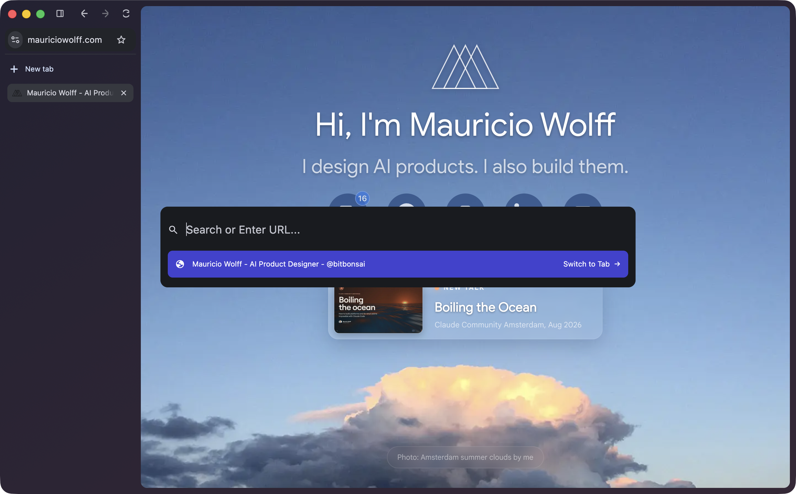

Arc has a lot of ideas worth keeping. Spaces and named pinned tabs make the sidebar feel like a workspace. The command bar gives you a quick way back into it.

Now [Arc is being sunsetted](https://arc.net/). I want that way of browsing to have a future. That's why I'm building myArc, an independent, open-source browser based on Chromium.

## A browser should work without an account

I'm positive about this one. Opening a browser and using your own workspace should work without signing up for anything. Local browsing, migration and export must stay usable without an account or subscription.

The privacy commitment is no behavioral tracking. myArc will not send browser-usage analytics or create per-install tracking identifiers. Browsing history and workspace data stay local by default. A release audit must check Chromium's defaults and network behavior against that commitment.

I can follow aggregate release-download counts to see whether people are trying it. GitHub already provides those totals. That gives me a useful signal without instrumenting people's browsing. Website and download hosts may still keep operational request logs, which need separate disclosure.

## Trying Artcraft's way of working

I'm using [Artcraft's public engineering practices](https://github.com/bitbonsai/myarc/blob/main/docs/ARTCRAFT-WORKFLOW.md) as a starting point. PhotoCraft's development guide separates native visual checks from model tests. A passing test and a working application tell you different things.

For myArc, Chromium provides the browser services. Rust handles the workspace logic we own.

Each coding agent gets a narrow job and a result I can check. Today's tasks cover the Rust Spaces model and a Profile-owned workspace service. Another agent is wiring that state into the native sidebar.

A separate agent reviews the change. Findings go back for another implementation pass. The lead agent brings the Rust and Chromium changes together, builds the browser and checks the native window.

GPT-6.1 (`gpt-6.1-sol`) leads the browser work with high thinking. Claude Sonnet 5.5 (`claude-sonnet-5-5`) reviews changes at high effort.

## Keeping context between sessions

I've open-sourced two skills under bitbonsai: [context](https://github.com/bitbonsai/context) and [wrap](https://github.com/bitbonsai/wrap).

Context keeps agent instructions and architecture notes current. A new agent needs to know which parts belong to Chromium and which belong to myArc. It also needs to tell planned work from working code.

Wrap saves useful gotchas and writes a handover for the next session. Private and machine-specific notes stay outside the public repo.

[myArc's code is open source too](https://github.com/bitbonsai/myarc).

## What broke along the way

Moving navigation controls into the sidebar caused startup and layout failures. Using Chromium's native controls fixed that path.

The address field had a different problem. Hiding and showing it during layout lost keyboard focus. Keeping it visible fixed navigation.

Those are now things to recheck when the controls move. Looking right is one check. Typing an address and opening the page is another.

## The current build and the target

Page navigation and the centered native command palette already work. Today's goal is an Arc-like empty window and a nightly build people can try without compiling Chromium.

*myArc, with the native command palette open.*

*Arc, our visual reference.*
