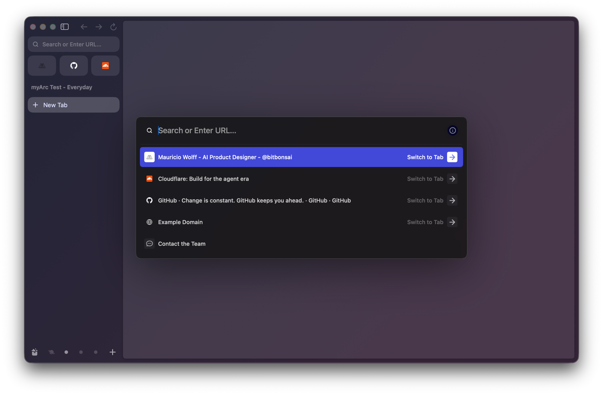

myArc now has a site. This blog is where I'll keep the development record, including the decisions we have to revisit.

The first landing page already gave us something to write about. Tiny section labels occupied an entire column. The progress panel had too much empty space, while its text felt small. Some requested changes were discussed before they were deployed. Reviewing a page gets frustrating when you're looking at an older version than the one being described.

We changed the layout, made the type larger, and started checking the actual published HTML against the built file. The public page is part of the work to verify.

## Where we want to get

*Arc reference, supplied for this post. This is the target appearance; myArc remains a prototype.*

The sidebar keeps navigation close to the tabs, while the centered command bar gives an address or search room to breathe. This is the experience we want to bring back. Our native Chromium experiment is still working toward it.

## Borrowing a working method from Artcraft

Artcraft was a useful reference for how to organize the development process. In particular, PhotoCraft's public [development guide](https://github.com/storytold/photocraft/blob/main/docs/development.md) and [scorecard](https://github.com/storytold/photocraft/blob/main/docs/scorecard.md) influenced the approach.

The useful part is the discipline around evidence: choose a bounded task, make the result observable, and record what actually ran. A successful build should be followed by checking the running application. We also check that visible controls have an effect and that screenshots match the version under review.

We've written down [how we're adapting those practices](https://github.com/bitbonsai/myarc/blob/main/docs/ARTCRAFT-WORKFLOW.md). A browser has different constraints from a graphics editor, especially around profiles, extensions and security updates. Those decisions need their own investigation.

## Chromium for the browser, Rust for myArc's rules

The current direction is to preserve Chromium's complete browser implementation and keep the myArc-owned workspace rules in Rust. That includes the planned workspace model, import, persistence and shared commands.

Chrome extension support depends on browser services beyond the rendering engine. Replacing that platform with a generic webview would create a much bigger compatibility problem to solve.

There is a small Rust/native Chromium experiment already. A complete myArc browser and importer remain unimplemented. The [architecture notes](https://github.com/bitbonsai/myarc/blob/main/docs/ARCHITECTURE.md) describe the intended boundaries and the evidence still needed.

## Models and effort are part of the record

For the website design pass, I asked for Claude Fable 5.1 at **high effort**, using the `/frontend-design` skill. The recorded model identifier was `claude-fable-5-1`. The coding session used to build this blog reports `gpt-6.1-sol`.

High effort still needs visual review. The first layout wasted space on small labels. The revised brief asked for headings above their content, a consistent type scale, and a smaller illustration inside the progress panel. We then checked desktop and mobile layouts, along with both color schemes.

Future posts will identify the model and effort setting when those details are verified, alongside the task and how we checked the result.

## Obstacles worth keeping

Certificate provisioning was an early deployment problem. DNS resolved correctly, but GitHub Pages kept serving a certificate for `*.github.io`. Normal HTTPS verification correctly rejected it for `myarc.dev`.

After checking GitHub's documented recovery steps, we removed and re-saved the Pages custom domain. The certificate was then approved for the apex and `www`. We checked the served page before enabling HTTPS enforcement. The DNS records stayed unchanged during that restart.

We also caught a smaller reproducibility issue: font conversion was rewriting timestamps, making unchanged builds produce different HTML. Preserving the source font timestamps made consecutive builds byte-identical.

Those are the kinds of details I want to keep here. The failed attempt often explains the eventual implementation better than the final diff does.

## A small blog we can maintain

Posts are Markdown files with screenshots beside them. A build generates the index and article pages, using the website's branding and system color preference. Publishing stays in Git.

The first browser check caught the new Blog link disappearing on smaller screens. Existing mobile navigation rules were winning over its style. We corrected the selector and kept a visibility check at mobile widths.

Raw HTML in posts is disabled. Screenshots must be local files, and drafts stay out of the website until explicitly marked for publication. Draft files in a public repository are still public, so private notes and real browser profiles belong elsewhere.

I'll use these posts to record discoveries, obstacles and the checks behind each change. Native browser screenshots will use synthetic tabs and data. Progress on the website will stay clearly separate from progress on the browser.
