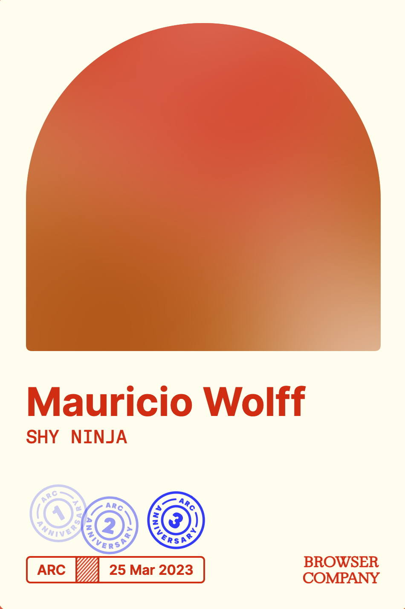
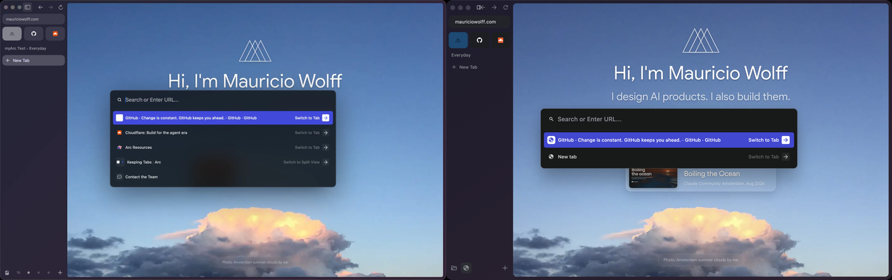

*My Arc card, 2023.*

I started using Arc in 2023. I like how its sidebar works. Spaces and named pinned tabs turn it into something closer to a desk than a strip of tabs, and the command bar gets me back to any of those tabs fast.

[Arc is being sunsetted](https://arc.net/). I didn't want to lose that way of browsing, so I asked myself the obvious question: why not make an open, private-first version of Arc, with AI as an option? That's how myArc was born. Right now it's a Chromium-based prototype, and this post is where I write down what I'm trying and what breaks along the way.

## What I want from it

I want to open myArc and start browsing without creating an account or paying for a subscription. Moving a workspace in or exporting it out should work the same way, on my own machine.

I also want it to be private. myArc won't send analytics about how you browse, and it won't create an identifier per install to track you with. History and workspace data stay on your disk by default. I haven't verified all of this yet, though. Chromium ships with its own defaults and network behavior, and before any release I need to go through them and check what actually leaves the machine.

I do want to know whether people try it. GitHub's aggregate download totals per release are enough for that. The website and download host may keep ordinary request logs, which I'll disclose separately.

## Trying Artcraft's way of working

I'm borrowing [Artcraft's public engineering practices](https://github.com/bitbonsai/myarc/blob/main/docs/ARTCRAFT-WORKFLOW.md) as a starting point. PhotoCraft's development guide separates those checks: model tests run on their own, and visual checks happen in the native app.

Moving the navigation controls into the sidebar broke startup and layout. Going back to Chromium's native controls fixed both.

The address field also lost keyboard focus when layout hid it and showed it again. Keeping it visible brought navigation back. The lesson for me is that any time those controls move, I recheck startup and keyboard navigation in the native app.

Chromium provides the browser services, and Rust handles the workspace logic that's ours. Agent tasks follow that line.

Each coding agent gets a narrow job with a result I can check myself. Right now that's the Rust Spaces model and a workspace service owned by a Chromium Profile, while another agent wires that state into the native sidebar. A separate agent reviews the change, and its findings go back for another implementation pass. The lead agent then merges the Rust and Chromium pieces, builds the browser and looks at the native window.

## Keeping context between sessions

Working this way means every new agent starts without the last one's context. I've open-sourced two skills under bitbonsai for that: [context](https://github.com/bitbonsai/context) and [wrap](https://github.com/bitbonsai/wrap).

Context keeps the agent instructions and architecture notes current, so a new agent can tell Chromium's parts from myArc's, and plans from working code.

Wrap saves the gotchas from a session and writes a handover for the next one. That's how the startup and focus failures above feed into the next pass instead of getting rediscovered. Private and machine-specific notes stay out of the public repo.

[myArc's code is open source too](https://github.com/bitbonsai/myarc).

## Where the build is

Page navigation works, and so does the centered native command palette. What I'm going for today is an Arc-like empty window and a native nightly build, so people can try it without compiling Chromium themselves.

*Arc on the left. The current myArc nightly on the right.*
