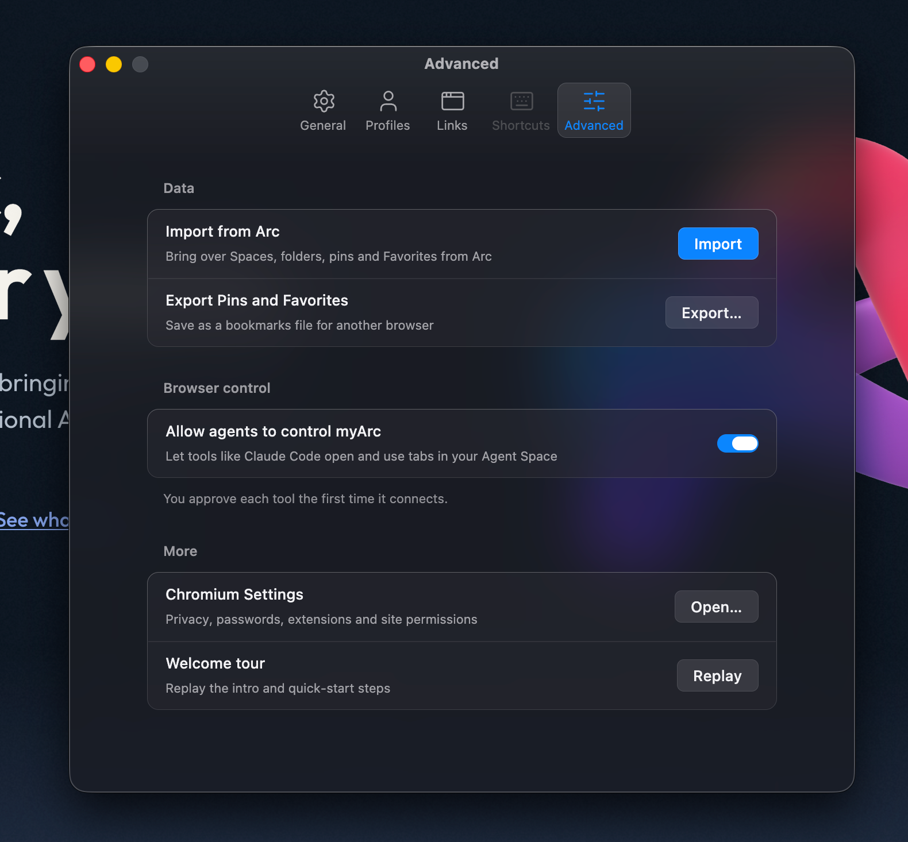
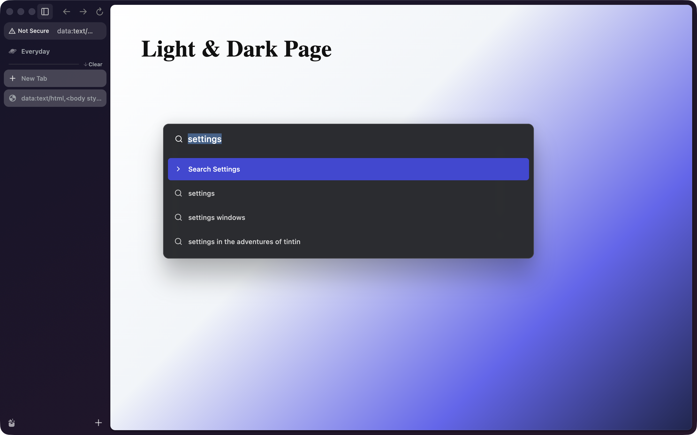
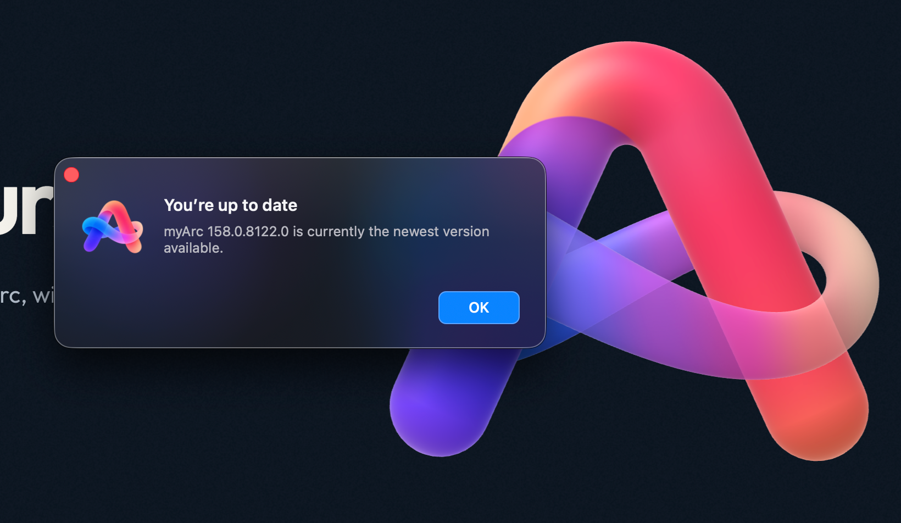
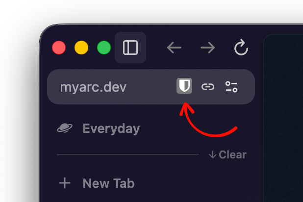

myArc alpha is here. That shifts what I spend time on. Most of the big pieces work now, so this round went to TLC. Opening each screen with fresh eyes, walking through the day-one flows, and fixing the rough spots that make an app feel unfinished.

## Cleaning up Settings

The Advanced tab had grown busy, with too many rows and a file picker sitting in the middle of the page. I pared it down to three cards so you can spot what you came for without scanning a wall of controls.

Import from Arc also got simpler. Instead of opening a file dialog right away, it looks for Arc on your Mac and jumps straight to the preview. The file picker only appears if Arc isn't installed.

*Advanced in Settings, down to three cards.*

## A calmer welcome

The welcome screen now matches the Mac it opens on. If Arc is installed, you get Import from Arc and Let's go. If it isn't, you only see Let's go.

No extra links or file pickers before your first tab is even open.

*The welcome, tour, and split view on a Mac with Arc installed.*

## Frosted glass everywhere

The sidebar has blurred your desktop for a while, so every time Settings or the command bar popped up as a flat dark box, it looked like it belonged to another app.

Settings, the command bar, Space panels, the theme and icon pickers, tour cards, dialogs, and the copy-link toast all share the same macOS vibrancy helper now. Behind-window blur, a thin border, and a tint that stays readable over both white and dark pages. Turn on Reduce Transparency in System Settings and they switch to solid panels.

*The frosted command bar over myarc.dev.*

Sparkle's built-in updater window was the last opaque gray box left. I replaced its UI with a custom user driver so updates arrive in the same frosted glass as the rest of myArc. Automatic background checks and EdDSA signature verification are untouched; only the window changed.

*The frosted updater window over the myArc page.*

## Extensions in the URL pill

Testing Bitwarden from the Chrome Web Store caught a real gap. It installed cleanly and survived a restart, then I had nowhere to click it because the sidebar header hid Chromium's extensions container.

Pinned extension icons now live at the right end of the URL pill. At rest you only see the address. Hover over the pill and your pinned icons show up next to Copy URL. Clicking one opens its popup and keeps it visible until you close it, and pressing ⌘L hides them again so you get the full width to type.

The bundled uBlock Origin Lite starts unpinned now (including a one-time unpin for existing profiles), since the site info popover already has a switch for it. Chromium's Safety Check also stopped flagging it as an unverified extension.

*Bitwarden pinned in the URL pill on hover, beside Copy URL and site info.*

## Try it

Everything here is in alpha nightly `2026.11.22.2` on the [download page](https://myarc.dev/download/), or via myArc → Check for Updates… if you are already on a recent nightly. The code is [on GitHub](https://github.com/bitbonsai/myarc).
