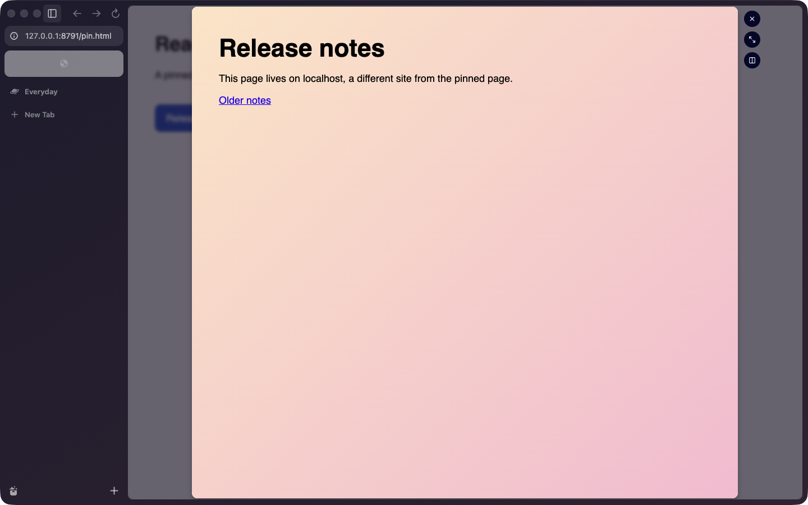
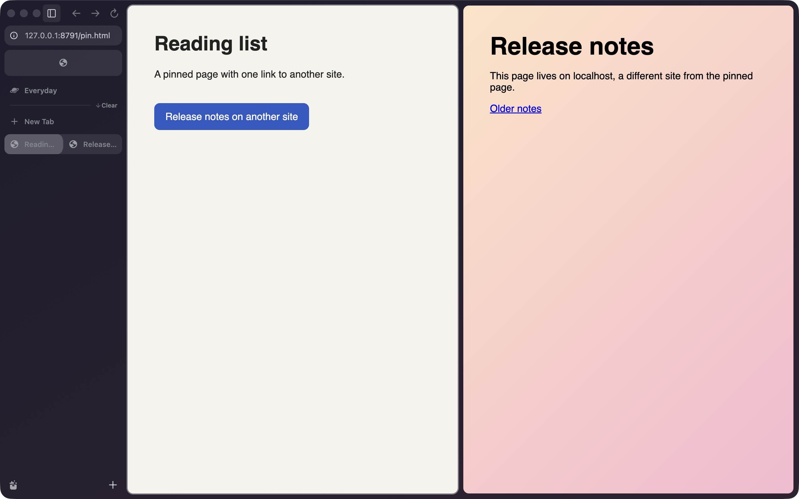
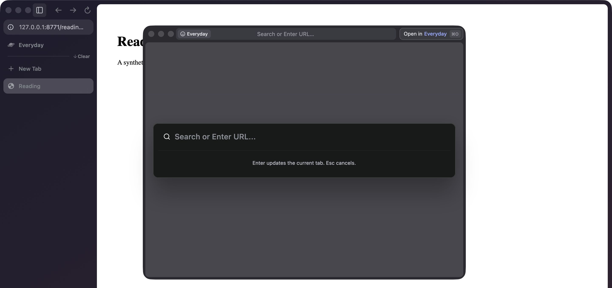
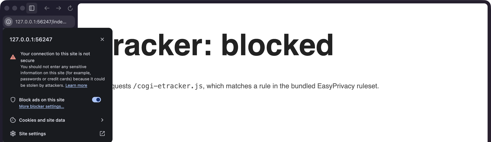

Arc is a very good browser, and on December 22, 2026 it [stops working](https://arc.net/). The Browser Company is pointing people to Dia instead. Spaces, Peek, Little Arc and the sidebar of pinned tabs add up to a way of browsing I haven't found anywhere else, and I'd hate to see it disappear with the app.

**myArc is my bet that the community can keep those ideas alive and keep making them better**, in a browser that doesn't ask for an account before you can use it.

This round was a big one. Most of what makes Arc feel like Arc now works in myArc.

## Bring your Spaces

Make an export from Arc before December 22, even if you're not ready to switch, because the export only works while Arc does. myArc turns that file into Spaces, folders and pinned tabs, then shows you what it added, with a count for each kind.

*The report after importing a test export.*

Arc's export holds names and links and little else, and the report says so up front. Favorites arrive as pinned tabs, and each tab shows a short address until you open it once and the page names itself.

## Peek

If someone asked me why Arc feels different, I'd show them Peek. Click a link in a pinned tab that leads to another site, and the page opens in a card while yours blurs and dims behind it. Close the card and you're right where you were, with no stray tab in the sidebar.

*A link from a pinned tab, open in Peek.*

The card grows in when it opens and shrinks away when you close it. Cmd+O keeps the page as a regular tab, and Cmd+Shift+T brings back a card you closed too fast. The third button beside the card puts the page next to the one you came from, which is handy for reading release notes beside the docs they change. If you'd rather have plain tabs, Settings has a switch that turns Peek off.

## Two pages side by side

Split View puts two tabs in one window, and the sidebar shows the pair as a single row with both icons. The pair is still there after a restart. New Split opens the command bar, myArc's search and action box, in the empty half, so you type your way to the second page like in Arc.

*Release notes beside the reading list that linked to them.*

## Little Arc

Little Arc is a small window with one page and no sidebar. It's for quick lookups and for links clicked in other apps, so a link from a chat doesn't land in the middle of whatever Space you had open. Option-Cmd-N opens one from any app, and once myArc is your default browser, links from other apps open there too. If the page turns out to matter, Cmd+O moves it into your Space.

*A fresh Little Arc, ready for a search.*

## The small habits

Plenty of this round went into things you only notice when they're missing. Ctrl+Tab jumps back to the last tab you used. Typing "/" in the command bar lists actions such as pinning a tab or switching Spaces. A pinned tab that wandered off shows a slash after its name, and clicking its icon takes it home. You can delete a Space or change its theme after making it, drag Favorites into a new order, and clear one site's cookies from the View menu.

## Safe to try

Trying a browser from someone you've never met takes some trust, so this round also covered the parts that earn it.

Ads and trackers are blocked from the very first page. Each Profile in myArc keeps its own cookies and logins, and each gets its own copy of uBlock Origin Lite, a lighter edition of the uBlock Origin blocker. If a site breaks, the "i" in the address field has one switch that turns blocking off for that site.

*A test page whose tracker never loaded, and the switch that controls it.*

Your sidebar holds up through a crash. Every pin and rename is on disk before the sidebar shows it, and a test kills the browser right after each one to prove it stuck. If the file ever gets damaged, myArc opens the copy it saved before.

A download now opens like any other Mac app. The nightlies are notarized, which means Apple scans each build before it ships, so the old security warning is gone. I've only tried that first open on the Mac that builds it, so tell me if yours complains.

## What's next

This week a tester agent drove a nightly with a real mouse and keyboard. It found two bugs, and both were fixed the same day. Next comes a welcome tour for new users, and the [alpha checklist](https://github.com/bitbonsai/myarc/blob/main/docs/ALPHA.md) has the rest.

Everything above is in the latest nightly on the [download page](https://myarc.dev/download/). Arc still does a few things myArc doesn't, and that list got a lot shorter this round. The code is [on GitHub](https://github.com/bitbonsai/myarc) if you'd like to help keep Arc's ideas going.
